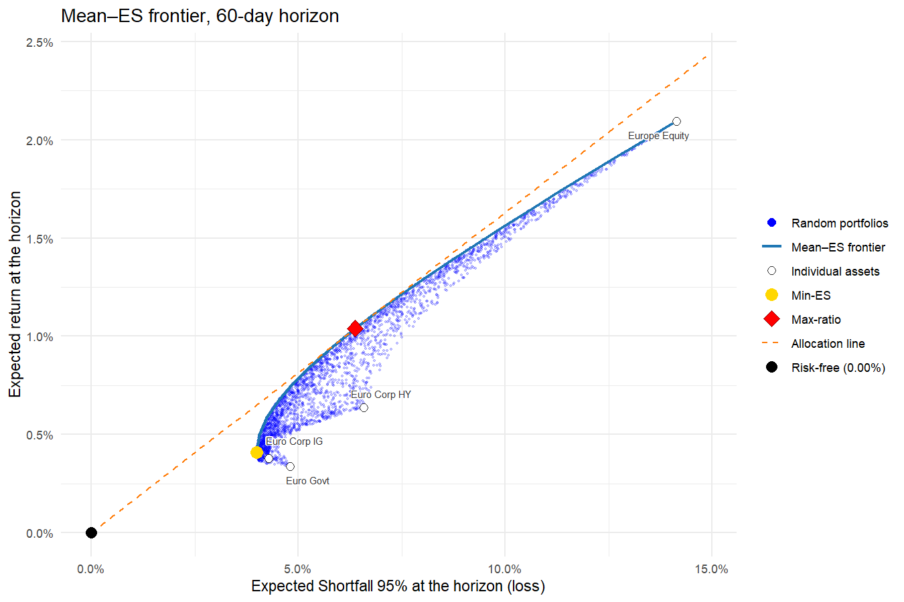
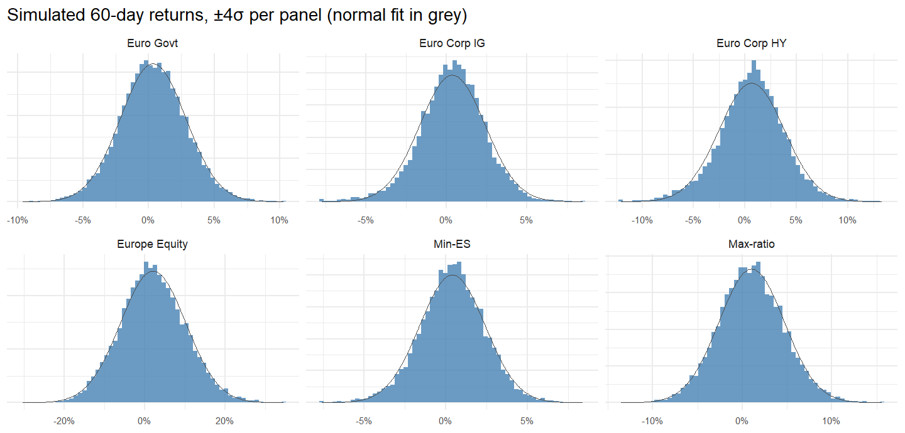

# Asset Allocation EUR (R)

Simulation-based asset allocation across four euro-denominated asset classes,
using daily prices from Yahoo Finance. Instead of assuming a covariance matrix,
the analysis resamples history to build 10,000 scenarios of 60-business-day
returns and optimises portfolios on Expected Shortfall (ES), the average loss in
the worst 5% of scenarios. The optimiser is validated against an independent
reference implementation on identical scenarios (see
[Tests and verification](#tests-and-verification)).

The R Markdown notebook downloads prices (with an on-disk cache) and computes:

- **data and cache**: adjusted daily prices for the four ETFs, cached as RDS;
- a **bootstrap** that resamples whole historical days (or whole weeks, see
  `RETURN_FREQ`) over a horizon of 60 business days, 10,000 times, giving the
  joint distribution of the four asset classes at the horizon;
- **ES at 95%** as the risk measure, reported as a positive loss;
- the **minimum-ES** portfolio, the **maximum return/ES ratio** portfolio and the
  **mean-ES efficient frontier**, all solved exactly by linear programming
  (Rockafellar-Uryasev) with the HiGHS solver;
- **per-asset weight bounds** (`BOUNDS`), minimum and maximum for each asset class;
- the **distributions at the horizon** of each asset and of the two optimal
  portfolios: mean, median, standard deviation, VaR, ES, probability of loss,
  worst and best scenario, and a histogram per series.

The first chart shows a cloud of random portfolios, the frontier, the two
optimal portfolios, the individual assets and the allocation line from the
risk-free point through the Max-ratio portfolio, in the (ES, expected return)
plane:



The second shows the distribution at the horizon of each asset and of the two
optimal portfolios:



## Universe

Each asset class is represented by a UCITS ETF quoted on Xetra in EUR.
Distribution-adjusted prices make each series a proxy for the asset class
total-return index.

| asset class | ticker | ETF |
|---|---|---|
| Euro government bonds | `EUNH.DE` | iShares Core € Govt Bond |
| Euro corporate IG | `EUN5.DE` | iShares Core € Corp Bond |
| Euro corporate HY | `EUNW.DE` | iShares € High Yield Corp Bond |
| European equity | `EXSA.DE` | iShares STOXX Europe 600 |

The common history starts in December 2010, when the high-yield ETF was
launched.

## Getting started

Requires R >= 4.3 and RStudio.

```r
source("install.R")   # quantmod, highs, Matrix, ggplot2, ggrepel, testthat, rmarkdown, knitr, jsonlite
```

Then open `Asset Allocation EUR.Rmd` in RStudio and click **Knit**, or from the
project folder:

```r
rmarkdown::render("Asset Allocation EUR.Rmd")
```

All tunable parameters (universe, start date, horizon, return frequency,
number of scenarios, ES level, risk-free rate, seeds, cache settings) are
defined in `R/params.R`. The
weight bounds are restated in the `parameters` chunk of the `.Rmd`, in `BOUNDS`:
edit them there and re-knit. Assets not listed get `c(0, 1)`.

```r
BOUNDS <- list("Euro Govt"     = c(0, 1),
               "Euro Corp IG"  = c(0, 1),
               "Euro Corp HY"  = c(0, 1),
               "Europe Equity" = c(0, 0.2))   # at most 20% equity
```

An unknown asset name, or inconsistent bounds, raises an error when the Run
chunk starts.

Rendering needs pandoc. RStudio ships one, so Knit works out of the box. From a
plain R session either install pandoc or point `RSTUDIO_PANDOC` at the folder
that contains it (RStudio keeps one under `resources/app/bin/quarto/bin/tools`)
before calling `rmarkdown::render`.

The first run downloads the prices (a few seconds); rendering takes about
half a minute, most of it in the 20 linear programs of the frontier (about one
second each on 10,000 scenarios).

## Project layout

```
Asset Allocation EUR.Rmd    # the notebook (source)
Asset Allocation EUR.html   # the rendered notebook
install.R                   # package installer
R/                          # parameters, data, simulation, metrics, optimisation, cloud, stats, plots
tests/                      # testthat suite, verify_real_data.R, cross_check/ fixtures
figures/                    # frontier.png, distributions.png
docs/                       # project-guide.pdf (and .tex): theory, methodology and code walkthrough; specs/
```

`R/all.R` sources the other files in order; the `.Rmd` calls it from the
project root.

## Data and caching

Adjusted close prices (dividends and splits) are downloaded from 2010-01-01 to
today via `quantmod::getSymbols` and cached as RDS under `data/cache/`. Rows
where every asset is missing (exchange holidays) are dropped. The cache expires
after 12 hours (`CACHE_TTL_HOURS`). Each run prints where the data came from
(`[data] ...`):

```
fresh cache  ->  download  ->  stale cache  ->  error
```

- **The full history is always re-downloaded, never appended.** Yahoo restates
  the whole adjusted history after every dividend or split, so appending new
  rows to old ones would mix two adjustment bases.
- **A partial download never overwrites a good cache.**

To force a refresh, call `get_prices_and_logret(TICKERS, force_refresh = TRUE)`
or delete `data/cache/`.

Because the data runs up to the current date, results change from day to day.

## Modelling conventions

- **Horizon returns are simple returns** over `HORIZON_DAYS` business days,
  compounded from the daily returns of each bootstrap path.
- **Buy-and-hold**: weights are set at the start of the horizon and not
  rebalanced.
- **Days are resampled independently**, each with its historical cross-section
  of the four assets. Fat tails, skew and correlations are therefore those of
  the sample; there is no serial dependence (no volatility clustering, no
  momentum).
- **Daily or weekly resampling** (`RETURN_FREQ`, default `"daily"`). With
  `"weekly"` the daily log returns are summed within each ISO week and whole
  weeks are resampled: the dependence inside a week is kept, at the cost of a
  sample about five times smaller (about 830 weeks instead of 4,000 days).
  The horizon stays in business days and is converted to weeks (60 days = 12
  weeks); because of holidays a resampled week has on average slightly fewer
  than five trading days, so 12 weeks cover about 58 of them. The risk-free
  rate is still converted with 60/252.
- **ES is a positive number**: the average loss in the worst `1 - ES_LEVEL` of
  scenarios. VaR in the distribution table is a quantile of returns and is
  usually negative.
- **The return/ES ratio** is computed on excess returns over the risk-free rate
  and is the analogue of the Sharpe ratio.
- **Risk-free rate**: a fixed annual constant (`RISK_FREE`), set to zero.
- **The random cloud is illustrative only**; the optimal portfolios come from
  the linear programs.
- **Results depend on the download date and on the seeds** (`SIM_SEED`,
  `CLOUD_SEED`); a different generator or seed gives a different set of
  scenarios and slightly different optima.

## Tests and verification

```r
testthat::test_dir("tests/testthat")
```

```bash
Rscript tests/verify_real_data.R
```

The testthat suite has 52 tests (175 expectations) and takes about a minute
and a half, most of it in the cross-check. `verify_real_data.R` runs brute-force and
consistency checks on the real cached data (LP objective against directly
computed ES, a weight grid that must never beat the LP, bounds respected,
monotone frontier, reproducibility); it takes about 2 minutes.

**Cross-check against a reference implementation.**
`tests/cross_check/` holds 10,000 x 4 bootstrap scenarios
(`reference_scenarios.csv`) produced by an independent implementation of the
same method, together with its Min-ES, Max-ratio and 50-point frontier results
(`reference_expected.json`). `test-cross-check.R` feeds those same scenarios to
the R optimiser and compares: Min-ES, Max-ratio and all 50 frontier points
agree to about 1e-12, with and without weight bounds. Any difference between
two full runs is therefore Monte Carlo error, not a difference in the
optimisation.

## Example output

Run on 2026-10-29, with data up to 2026-10-27:

```
Sample: 2010-12-15 to 2026-10-27, 4027 daily returns, 4 assets | horizon 60 days, 10,000 scenarios
Min-ES:     E[R]=0.40%  ES95=3.96%  ratio=0.101
Max-ratio:  E[R]=1.02%  ES95=6.28%  ratio=0.162
```

Weights (%):

| | Min-ES | Max-ratio |
|---|---:|---:|
| Euro Govt | 43.25 | 53.63 |
| Euro Corp IG | 46.36 | 7.59 |
| Euro Corp HY | 9.33 | 0.00 |
| Europe Equity | 1.06 | 38.79 |

On data downloaded the same day the reference implementation gives Min-ES
ES95 = 4.02% and a Max-ratio ratio of 0.165; the gap is Monte Carlo error, since
the two draw different scenarios.

The Max-ratio objective is flat near its optimum: on the same scenarios a mix of
40% Govt / 23% IG / 37% equity reaches a ratio of 0.161 against 0.162 at the
optimum (54 / 8 / 39), so a different bootstrap draw can move the weights a lot
while the ratio barely changes; the Min-ES weights are stable.

## Disclaimer

This project is for educational purposes only and is not investment advice.
Estimates based on historical returns do not predict future performance.

## License

[MIT](LICENSE)
